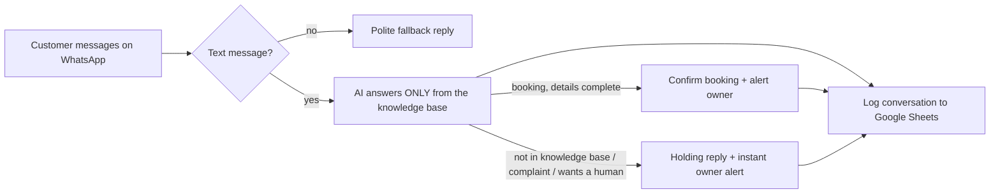

# WhatsApp AI Assistant — n8n + AI

**Your front desk, on WhatsApp, 24×7.** Answers customer questions from *your own* price list and policies, books appointments, and hands off to you the moment a human is needed — with every conversation logged.

Built by [Forethinq Labs](https://github.com/ForeThinq). The demo business is a fictional salon (**Glow & Co, Bandra West**); the same build fits clinics, real-estate offices, dealerships, hotels, and home services.

**Status:** workflow (19 nodes) plus a separate error-handler workflow, knowledge base, and a 7-message test script. Code logic and live model behaviour are tested (see the tested-on line below), and on 10 Nov 2026 the shipped JSON imported into n8n and **ran in n8n with stubbed nodes** — the WhatsApp, Google Sheets, and Gmail nodes were stubbed, so the live run (wire the free Meta test number, send the script from a phone) is still pending, and this page will carry those results when it happens.

**Tested on:** 9 Nov 2026. Logic tests: 23/23 passed (Node, running the workflow's own Code-node JS — validation, injection containment, non-text fallback, error markers). Live model tests: the 6 text cases from `sample-conversations.md` run against `gemini-3.1-flash-lite` (fallback order `gemini-3.5-flash-lite`, then `gemma-4-31b-it`; the primary model never errored, so the fallbacks were listed on the key but not called). All 6 behaved as expected — including the two traps: keratin escalated with no invented price, the complaint handed off. One real miss was found and fixed during testing: the model confirmed a booking for "tomorrow" that fell on a closed Tuesday, because the prompt carried no current date; the prompt now injects today's date and the re-run refused the closed day and offered the next open one. Full record: [`TEST-RESULTS.md`](TEST-RESULTS.md). The non-text case (script #7) is unit-tested only as a live case — it has since run inside n8n with stubbed nodes (below). **n8n stub run, 10 Nov 2026** (n8n 2.46.6): both shipped workflow files import exactly as shipped, and the main workflow ran end to end in n8n with the WhatsApp, Sheets, and Gmail nodes stubbed — 4 cases, all passed: a price question answered and logged `Answered`; a keratin handoff logged `Handed Off` with the owner-alert path firing; an image message took the non-text fallback and logged `Non-text Fallback`; and with the shipped Gemini node left in place on its placeholder key, the real Google API returned 400 and the conversation logged `Handed Off` via the AI-failure path with the owner alert firing. Still untested: the live run with real WhatsApp/Sheets/Gmail — that needs a Meta test number and real Google credentials.

**What was tested live, what was tested with stubbed nodes, and what still needs a live test**

- **Tested live:** the real Gemini API (`gemini-3.1-flash-lite`) — the 6 text cases from `sample-conversations.md`, with prompts built by the workflow's own Knowledge node and each response passed through its Parse & Validate Reply code, sent through a vault-backed Gemini client, not through the workflow's HTTP node inside n8n. The raw prompts and responses are in `live-prompts/`.
- **Tested with stubbed nodes:** it **ran in n8n with stubbed nodes** (n8n 2.46.6, 10 Nov 2026) — the WhatsApp trigger was replaced by a manual trigger with seeded WhatsApp webhook payloads, every WhatsApp, Google Sheets, and Gmail node was a Code passthrough stub, and the Gemini node returned canned responses on the happy paths. Four cases ran end to end with no execution error: price question (`Answered`), keratin handoff (`Handed Off`, owner alert fired), non-text image message (`Non-text Fallback`), and AI failure (that case kept the shipped Gemini node, whose placeholder key drew a real 400 from Google, and landed on the handoff path). Separately, 23 unit tests in Node run the workflow's Code-node logic with mocked n8n helpers, covering validation, injection containment, the non-text fallback (test script #7), and error markers.
- **Still needs a live test:** **live Google/WhatsApp still pending** — run it end to end with a Meta WhatsApp test number and real Google credentials: WhatsApp trigger webhook and all WhatsApp sends, Sheets conversation log writes, Gmail owner alerts, the error workflow firing live, a real non-text message from a phone, and the fallback models (`gemini-3.5-flash-lite`, `gemma-4-31b-it`) if the primary model ever errors.

## What this is

This project is a working demo of a **WhatsApp assistant for a small business**, built as an importable n8n workflow. The problem it solves: customers message a business on WhatsApp while the owner is busy or closed, get no reply for hours, and book somewhere else. This assistant answers instantly, but only from the business's own price list and policies. It takes bookings, writes every conversation into a Google Sheet, and the moment a question is outside what it knows, or a customer is unhappy, it steps aside and alerts the owner instead of guessing.

<!-- SCREENSHOTS — embeds ready, uncomment when the files land in assets/ after the live run; nothing here is faked

-->

## What it does

1. **WhatsApp Trigger** — incoming customer message (WhatsApp Business Cloud API).
2. **Extract Message** — pulls out the customer's name, number, and text; non-text messages (photos, voice notes) get a polite fallback reply instead of breaking the flow.
3. **Knowledge + Build Prompt** — the salon's services, prices, hours, and policies are the AI's *only* source of truth.
4. **AI Reply (Gemini)** — answers, qualifies, or books, returning structured JSON: the reply, the intent, whether a human is needed, and any booking details. The customer message reaches the model inside CUSTOMER_MESSAGE_START / CUSTOMER_MESSAGE_END markers, as data, never as commands.
5. **Validate Reply (code)** — before anything is sent, the reply is checked in code: empty or malformed output, a price that isn't in the knowledge base, an offered service the salon doesn't list, or a booking for an unlisted service — any of these blocks the send and routes to the handoff path instead.
6. **Send Reply** — only a validated answer goes back on WhatsApp.
7. **Log Conversation** — every exchange is appended to a Google Sheet (time, customer, message, reply, intent, handoff flag, status, notes). Every path lands here — answered, handed off, non-text fallback, and send errors alike.
8. **Alert Owner** — bookings, handoffs, and errors email the owner immediately with the full context. A separate error workflow covers execution failures.

## The rule that makes it safe

The assistant **cannot invent**. If a price or service isn't in the knowledge base, or the customer is upset or asks for a person, it sends a holding reply and escalates. That one rule is the difference between a helpful assistant and a liability — and it's enforced three ways: in the prompt, in a validation code node that checks every reply against the knowledge base *before* it can be sent, and in the handoff branch. Not left to luck.

## Two exchanges from the test script

The full script is in [`sample-conversations.md`](sample-conversations.md) — 7 messages, each with the behaviour it must produce.

**Customer:** "Hi! What are your prices for a haircut and facial?"
**Assistant:** answers from the knowledge base only — Haircut & Styling ₹499–₹899, Facial ₹1,299. Logged as a `price` intent, no owner alert.

**Customer:** "Do you do keratin treatment? How much?"
**Assistant:** keratin is **not** in the knowledge base, so it does not guess a price. The customer gets a polite holding reply, `needs_human` is set, and the owner gets an alert email.

## Tech stack

| Piece | Used for |
|---|---|
| n8n | Workflow engine — trigger, logic, orchestration (19 nodes + a 2-node error handler) |
| WhatsApp Business Cloud API | The channel — free Meta test number for the demo, your real number in a client build |
| Google Gemini (`gemini-3.1-flash-lite`) | The replies — grounded strictly in the knowledge base file; chosen for its higher free-tier limits, with `gemini-3.5-flash-lite` and `gemma-4-31b-it` as documented fallbacks |
| Google Sheets | One logged row per conversation |
| Gmail | Owner alerts for bookings and handoffs |

## Files

| File | What it is |
|---|---|
| `workflow-whatsapp-assistant.json` | The workflow — import into n8n |
| `workflow-error-handler.json` | The error workflow — import first, then link it in the main workflow's settings (step 6 below) |
| `salon-knowledge.md` | The knowledge base (edit this to retrain the assistant for any business) |
| `sample-conversations.md` | A 7-message test script with expected behaviour for each |
| `TEST-RESULTS.md` | What was tested, on which model, and what passed — logic tests and live model runs |
| `test_logic.js` | The unit tests — they run the workflow's own Code-node logic in Node. Run: `node test_logic.js` |
| `live-prompts/` | The raw prompts and model responses from the live test runs (6 cases) |
| `build_workflow.py`, `build_prompts.js`, `run_live.py`, `eval_live.js` | The build and live-test runners that produced the workflow JSON and the live results |

## Setup (about 20 minutes)

1. **Import the JSON** into n8n (Workflows → ⋯ → Import from File).
2. **WhatsApp credentials (free test setup):** create an app at [developers.facebook.com](https://developers.facebook.com) → add the WhatsApp product → use the provided **test phone number** → add your own phone number as a recipient. Copy the test number's Phone Number ID and a temporary access token into n8n's WhatsApp credentials (used by both WhatsApp nodes and the trigger). In the trigger, Meta also asks for a webhook callback — when running n8n locally, expose it with `npx n8n --tunnel` or your own HTTPS tunnel.
3. **Google Sheet** with a tab named `Conversations` and headers: `Time | Customer | Phone | Customer Message | Reply Sent | Intent | Needs Human | Status | Notes`. Connect your Google account in the Sheets and Gmail nodes and select the sheet.
4. **Gemini key:** get a free key from [Google AI Studio](https://aistudio.google.com/apikey) and replace `YOUR_GEMINI_API_KEY` in the *AI Reply — Gemini* node — it sits in the `x-goog-api-key` **header**, never in the URL.
5. **Replace `YOUR_EMAIL@example.com`** in both Gmail nodes (owner alert in this workflow, failure alert in the error handler) with the owner's inbox.
6. **Link the error workflow:** import `workflow-error-handler.json`, open it and copy its workflow ID, then open the main workflow's Settings → Error Workflow and replace `REPLACE_WITH_ERROR_WORKFLOW_ID` with that ID. The exported file cannot carry the real ID — it belongs to your n8n instance.
7. **Activate**, then run through `sample-conversations.md` from your phone.

> Note: imports can't carry credentials, so after importing, open the three WhatsApp nodes and re-select the sender (test) number if the field shows empty — 30 seconds each.

## Failure handling

- **Non-text messages** get a fallback reply, not an error — and the exchange is still logged.
- **AI returns junk or is down** → the reply is blocked (or the call failure is caught), the customer gets a polite holding message, the owner is alerted, and the conversation is logged as Handed Off with the reason.
- **AI invents a price or a service** → the validation node blocks the send before it happens; same handoff path as above.
- **Unknown questions** are escalated, never guessed.
- **Every outside call retries 3 times.** A WhatsApp send that still fails is logged as an Error row and alerts the owner; a failed sheet write or alert email stops the run loudly and fires the linked error workflow, which emails the owner.

## Known limits

- **No dedupe.** If Meta redelivers the same webhook, the customer can get two replies and the sheet two rows. Fine for a demo; a client build should store processed message IDs.
- **The unlisted-service check is a watchlist** (keratin, balayage, waxing, and other common salon services) plus a strict price check against the knowledge base. A reply inventing a brand-new service name with no price attached could slip through — the owner alert is the backstop.
- **Relative days depend on the injected date.** The prompt carries today's date (Asia/Kolkata) so "tomorrow" resolves correctly and closed days are refused; multi-turn date reasoning beyond that is only as good as the model.
- **Model capacity varies.** The workflow pins `gemini-3.1-flash-lite`; if Google returns persistent 429/503s, swap the model name in the AI node's URL — first `gemini-3.5-flash-lite`, then `gemma-4-31b-it` — and re-run the test script.

## Want this for your business?

Forethinq Labs builds these end-to-end: knowledge base from your own documents, booking flow, human handoff, logging, and monitoring — in your own WhatsApp Business account, at a fixed price.

📧 forethinq@gmail.com · [GitHub](https://github.com/ForeThinq) · [Reddit](https://www.reddit.com/user/ForeThinq/)
